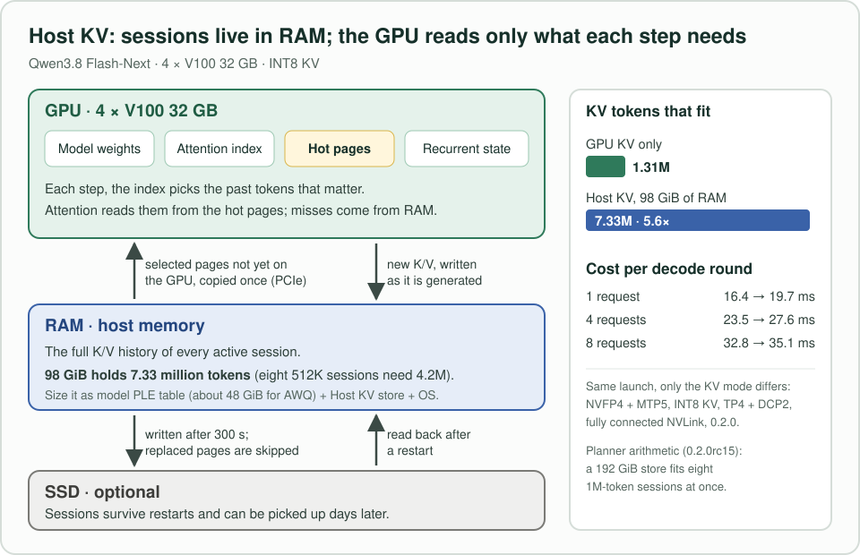

# ReVolta

**Stable, fast inference on multi-GPU NVIDIA V100 servers.**

ReVolta turns a server with four or more V100 32 GB GPUs and plenty of system memory into a dependable daily AI service for Qwen3.8 Flash-Next (text, images and video): an OpenAI-compatible API with the usual `vllm` command, a 512K-token context and eight concurrent requests. Pull the Docker image and launch; the profile recognizes NVLink or a PCIe switch with P2P, the two interconnects we test, and applies tuned settings by itself. Every release passes the same fixed gate on our own server, which runs ReVolta every day.

**You need:**

- Four or more V100 32 GB GPUs (validated on four), on NVLink or with all GPUs under one PCIe switch with P2P.
- 128 GiB of system memory recommended; 80 GiB is the smallest tested limit (0.1.0, KV offload off). For less, see the [experimental PLE disk option](https://github.com/Leonccaa/ReVolta/blob/main/docs/known-limits.md#whole-ple-table-on-disk-experimental).
- Linux x86-64 and an NVIDIA driver for CUDA 12.8.
- Docker with GPU support, or Python 3.12 with glibc 2.34 or newer.
- About 142 GB of disk for the default checkpoint. Tested hardware and limits: [Support and known limits](https://github.com/Leonccaa/ReVolta/blob/main/docs/known-limits.md).

**Current release: [0.2.0](https://github.com/Leonccaa/ReVolta/releases/tag/v0.2.0)**: INT8 KV by default, Host KV for many long sessions at once, and automatic NVLink tuning. Upgrading from 0.1.5: read the [release notes](https://github.com/Leonccaa/ReVolta/releases/tag/v0.2.0).

## At a glance

| ReVolta 0.2.0 | 4 × V100 32 GB PCIe, one switch with P2P, 200 W | 4 × V100-SXM2 32 GB NVLink, 300 W |
| --- | ---: | ---: |
| Output, 1 / 4 / 8 requests | 114 / 283 / 378 tok/s | **136 / 371 / 532 tok/s** |
| Cold prefill, 32K prompt | 3,787 tok/s (8.5 s) | **7,892 tok/s (4.2 s)** |
| GPU KV pool, MTP / DFlash2 | 1.19M / **1.85M** tokens | 1.31M / 1.78M tokens |
| Host KV pool, 98 GiB of RAM | **7.33M tokens** | **7.33M tokens** |
| 512K sessions running at once | 2–3 with GPU KV, **8** with Host KV | 2–3 with GPU KV, **8** with Host KV |
| GSM8K / MMLU | 90.0% / 87.7% | 90.5% / 88.0% |

Output: short synthetic prompts with 512 output tokens, the better of the tested MTP and DFlash2 setups at each concurrency (AWQ on PCIe; NVFP4 for MTP and AWQ for DFlash2 on NVLink). Quality: AWQ + DFlash2 on PCIe, NVFP4 + MTP5 on NVLink. Conditions and every configuration: [Performance](https://github.com/Leonccaa/ReVolta/blob/main/docs/performance.md).

### Host KV: many long sessions at once



Host KV keeps every session's K/V history in RAM; the GPU keeps the model, the attention index and the pages it reads right now. Flash-Next's sparse attention reads only a selection of past tokens each step, so this costs just **2–4 ms per decode round**.

| Sessions running at once, each at full length | 256K | 512K | 1M |
| --- | ---: | ---: | ---: |
| GPU KV | at most 4–7 | 2–3 | 1 |
| Host KV, 98 GiB of RAM | **8** | **8** | 6–7 |
| Host KV, 192 GiB of RAM | **8** | **8** | **8** |

With GPU KV every decoding request needs all of its K/V on the GPU, so the rest wait in the queue, and a few full-length sessions push the cache of the others out. How it works, sizing and when to use it: [Host KV](https://github.com/Leonccaa/ReVolta/blob/main/docs/host-kv.md).

## Models

**Any Qwen3.8 Flash-Next checkpoint in a supported weight format can be served: AWQ, ModelOpt NVFP4 and NVIDIA's NVFP4 / MXFP8 mixes.** The default INT8 KV cache computes a scale for every token and KV head at runtime, so no checkpoint-specific KV calibration pack is needed; it is also closer to FP16 than calibrated E4M3 (KL 0.024 vs. 0.061) and faster ([why](https://github.com/Leonccaa/ReVolta/blob/main/docs/checkpoints.md#weight-and-kv-formats)). Tested checkpoints:

| Model | Weights (bits per weight: routed experts / whole model) | Download | PLE table in host memory | GPU KV pool (0.2.0) | Quality vs its BF16 parent: KL ↓ / top-1 ↑ | Notes |
| --- | --- | ---: | ---: | ---: | ---: | --- |
| [Uncensored AWQ g32](https://huggingface.co/leoncca/Qwen3.8-Flash-Next-Uncensored-AWQ-g32) **(recommended)** | 4-bit AWQ g32 experts, FP8 PLE, BF16 rest (**4.63 / 5.95**) | 142 GB, MTP draft included | 48 GiB | 1,194,816 tokens (MTP4) | 0.0214 / 97.1% | Uncensored fine-tune; the reference setup |
| [Base AWQ g32](https://huggingface.co/leoncca/Qwen3.8-Flash-Next-AWQ-g32) | 4-bit AWQ g32 experts, FP8 PLE, BF16 rest (**4.63 / 5.95**) | 142 GB, MTP draft included | 48 GiB | Same layout as Uncensored | 0.0207 / 97.1% | The original model |
| [Standard NVFP4](https://huggingface.co/RadixArk/Qwen3.8-Flash-Next-NVFP4) | NVFP4 experts, FP8 PLE, BF16 rest (**4.50 / 5.86**) | 135 GB + 5 GB draft pack | 48 GiB | 1,488,853 tokens (MTP5) | 0.0303 / 96.4% | Widely used community format |
| [NVIDIA FP4-Local](https://huggingface.co/nvidia/Qwen3.8-Flash-Next-FP4-Local) | NVFP4 experts and PLE, MXFP8 attention and shared experts (**4.26 / 4.53**) | 102 GB, MTP layer built in | **27 GiB** | 1,518,412 tokens (MTP5 smoke test) | 0.0380 / 95.9% | NVIDIA's official checkpoint; least host memory |

The PLE tables (51 of the 177 billion stored parameters) stay in host memory by default. V100 has no BF16 units, so BF16 weights run in FP16. GPU KV pools are from the 0.2.0 PCIe startup logs (INT8, 512K, 8 sequences); quality is against each checkpoint's own BF16 parent ([method](https://github.com/Leonccaa/ReVolta/blob/main/docs/performance.md#quality-measurements)). Preparation and test status: [Checkpoints](https://github.com/Leonccaa/ReVolta/blob/main/docs/checkpoints.md). DFlash2 needs the separate [incoai DFlash2 drafter](https://huggingface.co/incoai/Qwen3.8-Flash-Next-DFlash2). Also supported: [NVIDIA NVFP4-QAD](https://huggingface.co/nvidia/Qwen3.8-Flash-Next-NVFP4-QAD) (serving checks passed) and text-only [Hy4-flash](https://github.com/Leonccaa/ReVolta/blob/main/docs/hy4-flash.md) (validation support).

## Quick start

1. Pull the image, or install the package (the Python import and the CLI stay `vllm`):

   ```bash
   docker pull ghcr.io/leonccaa/revolta:0.2.0
   # or, in a Python 3.12 virtual environment:
   pip install revolta==0.2.0   # the first start also needs the CUDA 12.8 Toolkit (nvcc)
   ```

2. Download the checkpoint and make its 512K views with [step 2 of Getting started](https://github.com/Leonccaa/ReVolta/blob/main/docs/getting-started.md#2-download-the-checkpoint-and-make-512k-views).
3. Launch with the reference command in [Getting started](https://github.com/Leonccaa/ReVolta/blob/main/docs/getting-started.md#4-launch) (pip) or its [Docker command](https://github.com/Leonccaa/ReVolta/blob/main/docs/getting-started.md#docker). The first start takes about 10–15 minutes (weights, PLE table, compilation).
4. Check that the server answers: `curl http://localhost:8000/v1/models` lists the model.

For another checkpoint, follow its [preparation guide](https://github.com/Leonccaa/ReVolta/blob/main/docs/checkpoints.md).

<a id="moved-sections"></a><a id="measurements"></a><a id="checkpoints-kv-scales-and-mtp-drafts"></a><a id="dflash2-speculative-decoding-optional"></a><a id="kv-offload-modes"></a><a id="weight-and-kv-formats"></a><a id="standard-nvfp4"></a><a id="performance"></a><a id="quality-measurements"></a><a id="support-and-known-limits"></a><a id="support-matrix"></a><a id="reporting-issues"></a>

## Documentation

| I want to… | Read |
| --- | --- |
| Install and launch the reference configuration | [Getting started](https://github.com/Leonccaa/ReVolta/blob/main/docs/getting-started.md) |
| Choose and prepare a checkpoint and its MTP draft, and choose the KV format | [Checkpoints and KV formats](https://github.com/Leonccaa/ReVolta/blob/main/docs/checkpoints.md) |
| Choose between MTP and DFlash2 | [Speculative decoding](https://github.com/Leonccaa/ReVolta/blob/main/docs/speculative-decoding.md) |
| Enable DFlash2 and choose its settings | [DFlash2](https://github.com/Leonccaa/ReVolta/blob/main/docs/dflash2.md) |
| Change the number of draft tokens with the batch size | [Dynamic speculative decoding](https://github.com/Leonccaa/ReVolta/blob/main/docs/dynamic-speculative-decoding.md) |
| Understand Host KV and decide whether it fits your team and server | [Host KV](https://github.com/Leonccaa/ReVolta/blob/main/docs/host-kv.md) |
| Keep evicted prefixes in CPU memory or on disk, or the KV cache in host memory | [KV offload](https://github.com/Leonccaa/ReVolta/blob/main/docs/kv-offload.md); every key and metric: [KV offload reference](https://github.com/Leonccaa/ReVolta/blob/main/docs/kv-offload-reference.md) |
| Look up launch options, environment variables, sampling defaults and memory budgets | [Configuration](https://github.com/Leonccaa/ReVolta/blob/main/docs/configuration.md) |
| Compare measured speed, KV capacity and quantization quality | [Performance](https://github.com/Leonccaa/ReVolta/blob/main/docs/performance.md) |
| Check the support scope and known limitations | [Known limits](https://github.com/Leonccaa/ReVolta/blob/main/docs/known-limits.md) |
| Set image and video input limits | [Multimodal input limits](https://github.com/Leonccaa/ReVolta/blob/main/docs/multimodal.md) |
| Watch one running service in a browser | [Dashboard](https://github.com/Leonccaa/ReVolta/blob/main/docs/dashboard.md) |
| See what the anonymous usage report contains, or turn it off | [Usage statistics](https://github.com/Leonccaa/ReVolta/blob/main/docs/usage-stats.md) |
| Run Hy4-flash (validation support) | [Hy4-flash](https://github.com/Leonccaa/ReVolta/blob/main/docs/hy4-flash.md) |

## Known limits

- **Scope.** V100 16 GB, GPU counts other than four, TP2/TP8 and other models have not been tested. Only SM70 is built: other GPU architectures, ROCm, CPU, XPU, TPU and GGUF are outside the build.
- **Reproducibility.** A single greedy request is reproducible bit for bit with a fixed configuration; with 2–8 concurrent requests, greedy outputs can change between runs.
- **Host memory.** The whole PLE table is pinned in host memory by default (about 48 GiB for AWQ and standard NVFP4, 27 GiB for FP4-Local); if it does not fit, startup stops and reports the required and available memory.
- **DFlash2 depends on the workload.** English and code gain the most, Chinese is often faster with MTP4; see [Choosing a method](https://github.com/Leonccaa/ReVolta/blob/main/docs/speculative-decoding.md#choosing-a-method).

The complete list and the test boundaries are in [Support and known limits](https://github.com/Leonccaa/ReVolta/blob/main/docs/known-limits.md). There is no GPU CI; releases are checked on the reference machine.

## Project direction

ReVolta focuses on dependable daily service on V100. Releases check output correctness, long-context retrieval, concurrent use, cache recovery and speed on the reference machine.

After 0.2.0, work continues on faster decoding with several concurrent requests, smoother service when long prompts arrive during decoding, and further tuning for NVLink systems. Longer-term work includes lower host-memory use and fewer runtime dependencies. There are no release dates.

## Getting help

Use [GitHub Issues](https://github.com/Leonccaa/ReVolta/issues). Include the launch command, relevant environment, ReVolta version, model revision, host or container memory limits, offload settings, `nvidia-smi topo -m`, and the `ReVolta profile` and `SM70 interconnect=` log lines. Remove credentials. Report security issues through GitHub private vulnerability reporting.

Reports from NVLink V100 owners are especially welcome; share measured results with the [test results template](https://github.com/Leonccaa/ReVolta/issues/new?template=test_results.md). Thanks to [@jttdev](https://github.com/jttdev), [@That80-20](https://github.com/That80-20) and [@vincentyan2023](https://github.com/vincentyan2023) for sharing their results ([#2](https://github.com/Leonccaa/ReVolta/issues/2), [#38](https://github.com/Leonccaa/ReVolta/issues/38), [#37](https://github.com/Leonccaa/ReVolta/issues/37)).

For project status and development background, read the [pinned overview (#1)](https://github.com/Leonccaa/ReVolta/issues/1). See [CONTRIBUTING.md](https://github.com/Leonccaa/ReVolta/blob/main/CONTRIBUTING.md) before preparing a contribution, and the [support scope](https://github.com/Leonccaa/ReVolta/blob/main/.github/SUPPORT.md) for supported versions.

## Building from source

See [BUILDING.md](https://github.com/Leonccaa/ReVolta/blob/main/BUILDING.md). Builds use Docker BuildKit, CUDA 12.8 and SM70 only; CUDA 13 cannot compile SM70. No GPU is needed to compile. Debug symbols are published separately.

## License and acknowledgements

ReVolta's engine code and project changes are licensed under the [Apache License 2.0](https://github.com/Leonccaa/ReVolta/blob/main/LICENSE), except for third-party files that state another license. [NOTICE](https://github.com/Leonccaa/ReVolta/blob/main/NOTICE) lists component attributions and known source-history gaps. [LICENSES/](https://github.com/Leonccaa/ReVolta/blob/main/LICENSES/README.md) contains the upstream license texts with their source revisions. Model weights have their own licenses; see each model card.

ReVolta is built on [1Cat-vLLM](https://github.com/1CatAI/1Cat-vLLM), a V100-focused fork of [vLLM](https://github.com/vllm-project/vllm), so the `vllm` command, its options and its OpenAI-compatible API work as usual. Thanks to the vLLM and 1Cat-vLLM contributors, and to the authors of the attention, quantization, communication and GPU kernel components included here (see NOTICE).

NVIDIA, Volta and Tesla are trademarks of NVIDIA Corporation and are used here only to identify hardware. ReVolta is not affiliated with or endorsed by NVIDIA.
