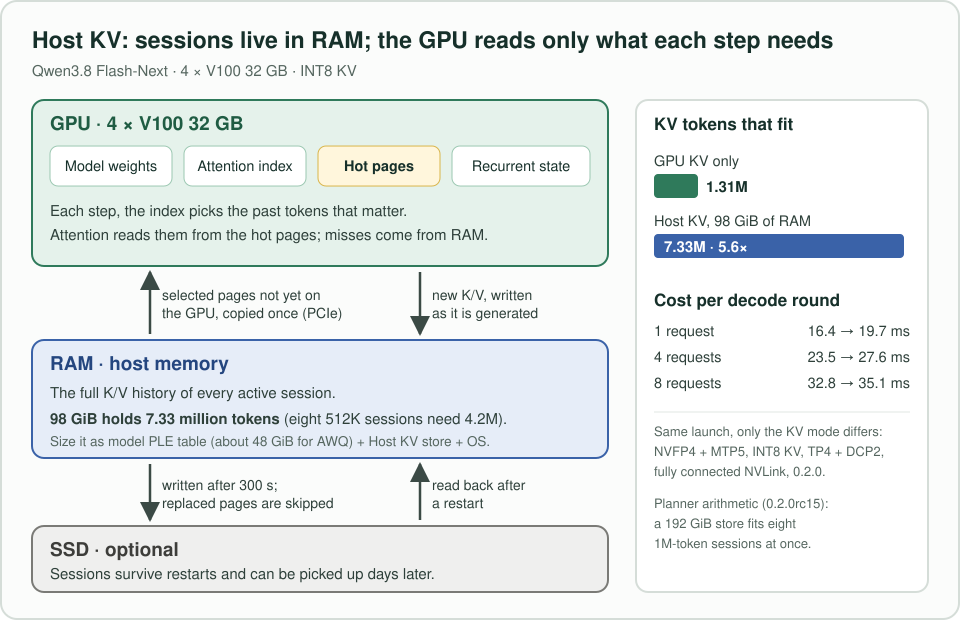

# Host KV: how it works and when to use it

Host KV keeps the attention history of every active session in system RAM instead of GPU memory. The GPU keeps the model, the attention index and a small pool of the pages it reads right now. On four V100 32 GB GPUs this raises the KV that fits from about 1.3 million tokens to **7.3 million tokens with a 98 GiB store**, at a cost of **2–4 ms per decode round**. An optional SSD keeps the pages across restarts.



This page explains the idea, the numbers and the use cases. Settings, requirements and checks are in [KV offload: Host KV](kv-offload.md#host-kv-long-context).

## Why we built it

- **GPU memory runs out first.** After the model and runtime buffers, a 32 GB V100 has about 6.3 GiB left for the KV cache. Across four GPUs that holds 1.2–1.9 million tokens: two or three full 512K sessions.
- **Teams keep long sessions open.** A small team working all day with coding agents and long documents keeps many long sessions open and comes back to them hours or days later. When the GPU pool is full, older sessions are evicted, and coming back to a 32K document then costs **8.5 s** of recomputation (33 s at 128K).
- **The memory is already in the server.** V100 servers usually have far more system RAM and NVMe storage than VRAM.
- **The model does not read the whole history.** Qwen3.8 Flash-Next uses sparse attention (QSA): a compressed index scores the past tokens, and each step reads only the selected groups. Most of the history can therefore stay off the GPU without being touched.

## How it works

### Where everything lives

| Part | Where | Notes |
| --- | --- | --- |
| Model weights | GPU | The PLE embedding tables stay in RAM in every mode (about 48 GiB for AWQ). |
| Attention index | GPU, split across the four GPUs | Decides which past tokens each step reads. |
| Recurrent (linear attention) state | GPU | Checkpoints are kept in RAM so a conversation can resume at the end of its last turn. |
| Hot pages | GPU | Holds the pages that attention reads now. Sized automatically and always large enough for every admitted request. |
| Full main K/V history | RAM (`/dev/shm`) | INT8 by default. This is where the capacity comes from. |
| MTP draft K/V | RAM by default | Read through the hot pages like the target. Can be kept on the GPU instead. |
| SSD copy | Optional | Pages are written after 300 s and read back after a restart. |

### One decode step

1. **Select.** Each GPU scores its part of the attention index and the GPUs agree on the top groups of past tokens for every row in the batch.
2. **Fetch only what is missing.** Groups already in the hot pages are read in place. Each missing group (four tokens of one layer on one GPU) is copied from RAM over PCIe once, even if several rows selected it.
3. **Attend.** Attention runs on the hot pages, exactly as it would on GPU KV.
4. **Write.** New K/V is written through to RAM as it is generated.

The traffic per step is small. For example, if two verify rows select groups `[834, 846]` and `[835, 846, 864]`, one GPU needs three distinct local groups. If one is already hot, it copies two groups of 2,080 bytes each: **4,160 bytes** for that layer.

### Prefill, revisits and restarts

- **Prefill** computes on the GPU as usual and writes the new K/V to RAM in coalesced copies.
- **Revisits** find their prefix in RAM. Recurrent-state checkpoints let a conversation continue from the end of its last turn without recomputing it.
- **Restarts:** with an SSD tier, pages are written after a 300 s delay, so pages that are replaced or evicted in that window are never written. After a restart they are read back into RAM.

## How much fits

| Four V100 32 GB, INT8 KV | GPU KV only | Host KV, 98 GiB store |
| --- | ---: | ---: |
| NVLink, NVFP4 + MTP5 (same launch) | 1,305,719 tokens | **7,330,944 tokens (5.6×)** |
| PCIe, AWQ | 1,194,816 tokens (MTP4) | **7,329,312 tokens** (MTP5) |

- **Per token,** the host store takes about 13.2 KB with DFlash2 and 14.4 KB with MTP4 (INT8, all four GPUs together). Divide the store size by this for a first estimate.
- **FP16 KV** holds about half as many tokens (3,832,192 in the same 98 GiB) and is slower; keep the INT8 default.
- **Long contexts** (planner arithmetic in 0.2.0rc15, AWQ, INT8, 8 sequences):

| Context per session | Host store | Sessions that fit at full length |
| ---: | ---: | ---: |
| 512K | 98 GiB | 8 |
| 1M | 98 GiB | 7 with DFlash2, 6 with MTP4 |
| 1M | 192 GiB | 8 |

Eight 1M-token sessions need 24.38 GiB of main K/V per GPU if kept in VRAM, against about 6.3 GiB available; in RAM they need 103.66 GiB ([#321](https://github.com/Leonccaa/ReVolta/pull/321)). A public report ran one request with **1,041,485 prompt tokens** in Host KV mode on four NVLink V100s with a 256 GiB store ([#199](https://github.com/Leonccaa/ReVolta/issues/199)).

## What it costs

Same launch on fully connected NVLink, 0.2.0, NVFP4 + MTP5, INT8 KV, only the KV mode differs:

| Requests | GPU KV, ms per round | Host KV, ms per round | GPU KV, output tok/s | Host KV, output tok/s |
| ---: | ---: | ---: | ---: | ---: |
| 1 | 16.43 | 19.68 (+3.3) | 136.1 | 113.6 |
| 4 | 23.45 | 27.58 (+4.1) | 370.9 | 314.1 |
| 8 | 32.81 | 35.11 (+2.3) | 532.4 | 503.3 (−5.5%) |

Accepted draft length was the same in both modes. On PCIe with AWQ + DFlash2 (0.2.0rc15), Host KV added 1.8 / 2.7 / 4.1 ms per round at 1 / 4 / 8 requests, and total output at eight requests fell from 338.1 to 316.3 tok/s (−6.4%). Both tests use short prompts; with long contexts the cost also depends on how many selected pages are not yet hot.

## When to use it

**Host KV fits when:**

- A small or medium team shares one server for long-running work: coding agents, long documents and research sessions that stay open for hours and are revisited over days.
- The active sessions together need more context than the GPU pool holds, for example eight 512K sessions (4.2 million tokens) against a 1.3 million-token GPU pool.
- The server has plenty of RAM and an NVMe SSD. Plan for the PLE table (about 48 GiB for AWQ, 27 GiB for FP4-Local) plus the Host KV store plus the operating system: about 256 GB for a 98 GiB store, 384 GB or more for 192 GiB.

**Stay with GPU KV when:**

- A few sessions at a time fit in the GPU pool (about 1.2–1.9 million tokens in total).
- The lowest latency per token matters most; Host KV adds 2–4 ms per round.
- The server has little RAM beyond the PLE table.

GPU KV with the CPU and SSD prefix cache sits in between: active sessions stay on the GPU, and a 32K prefix that was pushed out comes back in **0.6 s** from CPU memory or **1.0 s** from SSD after a restart. See [Choose a mode](kv-offload.md#choose-a-mode).

## Turn it on

Start from the [reference launch](getting-started.md) and replace `--kernel-config` and `--kv-transfer-config`:

```bash
--kernel-config '{"ple_disk_cascade": false,
    "long_context_kv": {"enabled": true, "host_store_gib": 98}}' \
--kv-transfer-config '{"kv_connector": "OffloadingConnector", "kv_role": "kv_both"}' \
```

Give the container a `--shm-size` larger than the store. At startup each worker logs the Host KV plan with the pool sizes and how many full-length requests fit; the engine refuses to start, and says what to change, if one request of `--max-model-len` does not fit. Requirements, the SSD tier and every setting: [KV offload: Host KV](kv-offload.md#host-kv-long-context) and the [reference](kv-offload-reference.md).

## Limits in 0.2.0

- FP16 Host KV uses a slower reader than INT8; keep the INT8 default.
- Host KV with DFlash2 is supported but was not tested separately in the 0.2.0 acceptance.
- Reading Host KV pages back from SSD after a restart was not measured in the 0.2.0 acceptance.
- Changing `qsa_dcp_index_shard` changes the page layout; SSD pages written with the other value are not read back.
